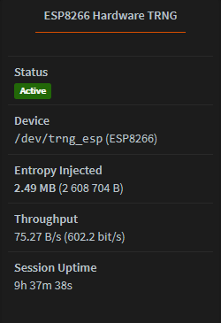

# Hardware TRNG (ESP8266 + CP2102) for OPNsense

A standalone, zero-component **Hardware True Random Number Generator (TRNG)** based on an ESP8266 microcontroller and a Silicon Labs CP2102 USB-to-UART bridge, built to feed high-quality hardware entropy directly into the FreeBSD **Fortuna** CSPRNG (`/dev/random`) on **OPNsense**.

Includes full service integration (`configd`, `devd`, `rc.syshook.d`), an automated health-check watchdog, a CLI diagnostic suite (`ENT` + `FIPS 140-2`), and a native **OPNsense Dashboard Widget** with zero-wear RAM (`/tmp`) telemetry.



---

## Key Features

* **Zero External Components:** Uses internal silicon power supply thermal noise (`ADC_MODE(ADC_VCC)` / `ESP.getVcc()`) combined with CPU cycle jitter (`ESP.getCycleCount()`) and non-periodic delays (`10 + ((vcc ^ c1) & 0x1F)` µs). Pin `A0` (`TOUT`) is left floating.
* **Hardware & Logical Data Diode:** The ESP8266 `RX` (`GPIO3`) line is physically disconnected from the adapter's `TX` pin and configured as `INPUT_PULLUP` right after `Serial.begin()`. This prevents any firmware reflashing or data injection from the router side.
* **EMI Shielding & Low Power:** Wi-Fi is hard-disabled (`WIFI_OFF` + `forceSleepBegin()`, ~15–20 mA draw). All unused GPIOs are pulled up/down internally to eliminate floating-pin electromagnetic interference.
* **Real-Time Multi-Stage Health Check:**
  1. *ADC Range Check:* Ensures `min_vcc != max_vcc` (verifies live ADC fluctuations).
  2. *Lag-1 & Lag-2 Pattern Lock:* Rejects stuck square waves (`101010...` and `11001100...`).
  3. *Monobit Bias Bounds:* Rejects blocks outside `1024..3072` ones per `4096` raw bits.
  4. *Cold-Start Discard:* Drops the very first block after power-on before emitting data.
* **Cryptographic Conditioning (Sponge Construction):** Mixes `512 bytes` of raw entropy with `32 bytes` of the previous SHA-256 state (`16:1` compression) via BearSSL SHA-256, outputting `32-byte` blocks at `115200 baud`.
* **Zero-Wear OPNsense Integration:** All 11 integration files live under `/usr/local/` (surviving reboots and firmware updates). Live telemetry is written strictly to `/tmp/esp_trng_stats.json` (RAM) to avoid SSD/flash wear.

---

## Hardware Wiring

Only **3 wires** are required between the ESP8266 module (ESP-12F / ESP-07 / ESP-01) and the CP2102 USB-UART adapter (`VID: 0x10c4`, `PID: 0xea60`):

| CP2102 Pin | ESP8266 Pin | Purpose |
| :--- | :--- | :--- |
| `3V3` | `VCC` / `3.3V` (+ `EN`/`CH_PD`) | 3.3V Power Supply |
| `GND` | `GND` (+ `GPIO15` on bare modules) | Common Ground |
| `RXD` | `TXD` (`GPIO1`) | Unidirectional Entropy Stream (`115200 8N1`) |
| `TXD` | *Not Connected* | **Data Diode** (isolated for security) |

> **Note:** Ensure `A0` (`TOUT`) has nothing connected to it, as `ADC_MODE(ADC_VCC)` measures internal supply voltage directly.

---

## Verified Entropy Benchmarks (Firmware v2.0)

### 1. Pre-Conditioning Raw Entropy (`NIST SP 800-90B`, 50,000 bytes)
* **NIST Min-Entropy (MCV):** `3.6930 bits/byte` (threshold for 16:1 compression: `>= 0.5000`, **7.38x safety margin**)
* **Raw Shannon Entropy:** `6.0688 bits/byte`
* **Raw Bit Bias:** `7.18%` (completely whitened by the SHA-256 extractor)

### 2. `FIPS 140-2` Statistical Suite (260,000 bits / 13 consecutive 20,000-bit blocks)
* **Overall Result:** `13 / 13` Blocks Passed (**100% PASS**)
* **Monobit Test:** `13/13 PASS` (last: `9954` ones; acceptable range: `9725–10275`)
* **Poker Test:** `13/13 PASS` (last: `8.24`; acceptable range: `2.16–46.17`)
* **Runs Test:** `13/13 PASS` (bit runs of length `1..6+` within bounds)
* **Long Run Test:** `13/13 PASS` (last max run: `17` bits; norm: `< 26`)

### 3. `ENT` Pseudorandom Sequence Test (32,500 bytes over 433.05 sec)
* **Throughput:** `75.05 B/s` (`600.4 bit/s`)
* **Shannon Entropy:** `7.9943 bits/byte` (ideal: `8.0000`)
* **Arithmetic Mean:** `127.19` (ideal: `127.50`)
* **Chi-Square (χ²):** `257.68` (`p-value: 44.12%`, normal range: `10–90%`)
* **Serial Correlation Coefficient:** `0.00283` (ideal: `0.00000`)
* **Unique Byte Values:** `256 / 256`
* **Monte Carlo π Estimation:** `3.14697` (`0.17%` error)

### 4. GRC DNS Spoofability Test (OPNsense Unbound)
* **Source Port Max Entropy:** `15.92–15.96 bits` (Excellent, `0` stuck bits)
* **Transaction ID Max Entropy:** `16.00 bits` (Excellent, `0` stuck bits)

---

## Installation

### Step 1: Flash the ESP8266
1. Open `firmware/esp8266_trng/esp8266_trng.ino` in **Arduino IDE** or **PlatformIO** (requires `ESP8266 Core 3.1.2+`).
2. Select your board (`Generic ESP8266 Module`), CPU Frequency: `80 MHz`, Flash Mode: `DOUT` (or matching your module).
3. Flash the firmware, then permanently disconnect the `TXD` wire from the CP2102 adapter.

### Step 2: Install on OPNsense
Connect the CP2102 adapter to your OPNsense router, log in via SSH as `root`, and run:

```sh
git clone https://github.com
cd opnsense-esp8266-trng
chmod +x install.sh uninstall.sh
./install.sh
```

After installation:
1. **Log out and log back in** to the OPNsense Web GUI to refresh ACL permissions (for non-root users, grant `Dashboard: ESP8266 Hardware TRNG` under *System → Access → Users/Groups*).
2. Go to **Lobby → Dashboard**, click **Add widget (+)**, and select **ESP8266 Hardware TRNG**.

---

## CLI Monitoring & Diagnostics

Run the built-in diagnostic tool to temporarily pause the background feeder, capture raw bytes over `/dev/trng_esp`, run `ENT` + `FIPS 140-2` validation, and automatically resume feeding:

```sh
# Quick test: 1 FIPS 140-2 block (2,500 bytes / ~35 sec)
esp-trng-test.sh

# Extended test: 4 FIPS 140-2 blocks (10,000 bytes / ~2.5 min)
esp-trng-test.sh 10000
```

Other useful commands:
```sh
# Check live RAM telemetry JSON
cat /tmp/esp_trng_stats.json

# Check service status via configd
configctl esp_trng status

# Inspect FreeBSD Fortuna RNG state
sysctl kern.random

# View watchdog events in system log
grep esp-trng /var/log/system/latest.log
```

## License

MIT License — see [LICENSE](LICENSE) for details.